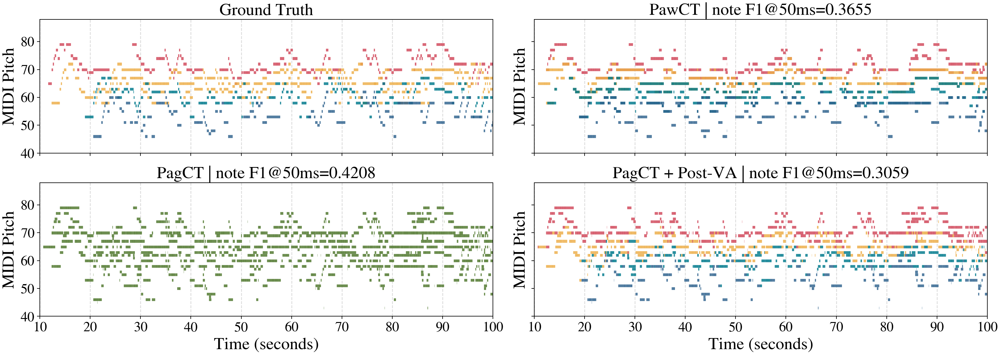

<h1 align="center">PawCT: Choral Audio → Separate SATB MIDI Tracks</h1>

<p align="center">
  Transcribe mixed choral audio into separate soprano, alto, tenor, and bass (SATB) MIDI note tracks.
</p>

<p align="center">
  <a href="https://hanyu-meng.github.io/Paw_Choral_AMT_Demo/">
    
  </a><br>
  <em>Click the preview to listen to the recording and compare transcriptions.</em>
</p>

<p align="center">
  <a href="https://hanyu-meng.github.io/Paw_Choral_AMT_Demo/"></a>
  <a href="https://huggingface.co/Hanyu-Meng/PawCT-PagCT"></a>
  <a href="#quick-start"></a>
  <a href="https://arxiv.org/abs/2610.09861"></a>
</p>

<p align="center">
  <strong>Toward Part-Aware Choral Transcription with Singing Voice Assignment</strong><br>
  Hanyu Meng · Zhanhong He · Zixun Guo · Yaolong Ju
</p>

**PawCT** transcribes mixed choral audio into separate soprano, alto, tenor,
and bass (SATB) note tracks. **PagCT** produces one merged note track. The
repository also provides **Post-VA**, a two-stage symbolic voice-assignment
baseline.

[Audio demo](https://hanyu-meng.github.io/Paw_Choral_AMT_Demo/) ·
[Quick start](#quick-start) ·
[Checkpoints](#checkpoints) ·
[Setup](#setup) ·
[Code walkthrough](docs/CODE_WALKTHROUGH.md) ·
[Data format](docs/DATA.md) ·
[Experiment protocol](docs/EXPERIMENT_PLAN.md)

## Quick start

**Just want to hear the results?** Open the
[audio demo](https://hanyu-meng.github.io/Paw_Choral_AMT_Demo/) to listen to
the recording and compare transcriptions without installing anything.

**Want to transcribe your own choral audio?**

1. Follow [Setup](#setup) to install the documented Python dependencies.
2. Download a [checkpoint and its matching inference configuration](#checkpoints):
   `pawct-base` for four SATB tracks, or `pagct` for one merged track.
3. Follow the [audio-to-MIDI Python example](https://huggingface.co/Hanyu-Meng/PawCT-PagCT#transcribe-audio)
   using the code revision specified in the model card, then point it to your
   choral audio file.

For separate SATB MIDI export, use the model-card Python example; the current
command-line inference entry point writes merged MIDI. Outputs are predicted
notes, not isolated vocal audio stems.

## Checkpoints

Download the PyTorch weights and the matching inference configuration. The
[Hugging Face model card](https://huggingface.co/Hanyu-Meng/PawCT-PagCT#transcribe-audio)
includes an audio-to-MIDI example for both models and the exact code revision
used to validate checkpoint loading.

| Model | MIDI output | Weights | Inference config | Frame / onset / offset thresholds |
| --- | --- | --- | --- | --- |
| **PagCT** | One merged track | [pagct.pth](https://huggingface.co/Hanyu-Meng/PawCT-PagCT/resolve/main/pagct.pth?download=true) | [pagct.json](https://huggingface.co/Hanyu-Meng/PawCT-PagCT/blob/main/pagct.json) | 0.07 / 0.03 / 0.003 |
| **PawCT base** | Four SATB tracks | [pawct-base.pth](https://huggingface.co/Hanyu-Meng/PawCT-PagCT/resolve/main/pawct-base.pth?download=true) | [pawct-base.json](https://huggingface.co/Hanyu-Meng/PawCT-PagCT/blob/main/pawct-base.json) | 0.05 / 0.01 / 0.01 |

PawCT base uses union supervision. The paper's **PawCT + RP + OC** variant
adds pitch-range and ordered-continuity priors. Re-scoring archived YouChorale
test predictions gave note F1 at 50 ms of **0.3790** for PagCT and **0.2248** for
PawCT base (macro SATB). The archived predictions lack a checkpoint hash, and
the threshold history includes test-set selection.
[Evaluation details](https://huggingface.co/Hanyu-Meng/PawCT-PagCT/blob/main/metrics.json) ·
[Checkpoint provenance](https://huggingface.co/Hanyu-Meng/PawCT-PagCT/blob/main/provenance.json) ·
[SHA-256 checksums](https://huggingface.co/Hanyu-Meng/PawCT-PagCT/blob/main/SHA256SUMS)

## Method at a glance

| System | Input | Output |
| --- | --- | --- |
| **PagCT** | mixed choral audio | one merged note track |
| **PawCT** | mixed choral audio | separate SATB note tracks |
| **PawCT + RP** | mixed choral audio | PawCT with a pitch-range prior |
| **PawCT + RP + OC** | mixed choral audio | PawCT with range and ordered-continuity priors |
| **PagCT + Post-VA** | PagCT notes | SATB labels assigned in a second stage |

PawCT uses a shared convolutional recurrent encoder with SATB-specific onset,
offset, and frame heads, plus an auxiliary part-presence head. Union-level
supervision preserves the note content of the mixture. In the current code,
trusted part labels remain fixed. RP suppresses unsupported out-of-range output
mass, and OC regularizes melodic motion between unambiguous consecutive note
events. Both priors apply during training.

- [PagCT and PawCT models](src/models.py)
- [Training losses, including RP and OC](src/losses.py)
- [Target construction](src/choral_targets.py)
- [Post-VA](src/train_midi_voice_assignment.py)

## Manuscript-reported results

| Task | System | Note F1 @ 50 ms |
| --- | --- | ---: |
| Part-agnostic | Yu et al. (2024) | 0.237 |
| Part-agnostic | **PagCT** | **0.382** |
| Part-aware, macro SATB | PagCT + Post-VA | 0.175 |
| Part-aware, macro SATB | **PawCT + RP + OC** | **0.225** |

These values come from the paper. The [reproducibility audit](docs/REPRODUCIBILITY.md)
documents how the original and current target and evaluation protocols differ.
Machine-readable paper results are available in [`repro/expected`](repro/expected).

## Repository structure

```text
src/          models, training, inference, decoding, and evaluation
tools/        audits and manuscript-style visualizations
tests/        unit and release tests
repro/        reported values, frozen splits, and audit records
docs/         technical documentation and a local demo preview
experiments/  exploratory models not reported in the manuscript
checkpoints/  artifact requirements for weight releases
```

## Setup

Python 3.11 was used in the audited environment. Install the PyTorch build
appropriate for your platform first, then install the remaining dependencies.

```bash
conda create -n pawct python=3.11 -y
conda activate pawct

# Select the appropriate PyTorch command from https://pytorch.org/get-started/locally/
pip install torch==2.10.0 torchaudio==2.10.0
pip install -r requirements-dev.txt

export PYTHONPATH="$PWD/src:$PWD/tools:$PWD/experiments${PYTHONPATH:+:$PYTHONPATH}"
```

The audited lab environment used PyTorch 2.10.0 with CUDA 12.8. CPU execution
is sufficient for tests, but not representative of training speed.

## Data preparation

YouChorale data is not redistributed. Set a local path to a legally obtained
copy with the following structure.

```text
YouChorale/
├── train.json
├── valid.json
├── test.json
├── audio/<recording-id>.(wav|mp3|flac|m4a)
├── midi/<recording-id>.(mid|midi)
└── note/<recording-id>.pkl
```

```bash
export YOUCHORALE_DIR=/absolute/path/to/YouChorale

python src/data_generator.py pack_youchorale_dataset_to_hdf5 \
  dataset.youchorale_dir="$YOUCHORALE_DIR" \
  exp.workspace=./workspaces \
  feature.sample_rate=16000
```

See [`docs/DATA.md`](docs/DATA.md) for annotation semantics, audio-boundary
handling, split requirements, and redistribution restrictions.

## Training

This example trains PawCT with the current target and evaluation protocol.

```bash
python src/main_iter.py \
  dataset.train_set=youchorale \
  dataset.test_set=youchorale \
  dataset.youchorale_dir="$YOUCHORALE_DIR" \
  model.arch=pawct \
  model.mode=frame_onset_offset \
  choral.enable=true \
  choral.target_assignment=part_name \
  choral.apply_presence_gate=false \
  feature.max_note_shift=0 \
  exp.workspace=./workspaces \
  exp.random_seed=86 \
  exp.batch_size=8
```

Use `model.arch=pagct` with `choral.enable=false` for part-agnostic training.
RP and OC are enabled through `choral.range_prior_loss_weight` and
`choral.continuity_prior_loss_weight`, respectively. Hyperparameters must be
selected on validation only.

The complete, auditable workflow—including frozen split manifests, RP/OC
settings, inference, validation-only threshold selection, and locked test
evaluation—is specified in
[`docs/EXPERIMENT_PLAN.md`](docs/EXPERIMENT_PLAN.md). Do not tune decoding
thresholds on the test set.

## Main entry points

| Task | Command |
| --- | --- |
| Train PagCT or PawCT | `python src/main_iter.py ...` |
| Run inference | `python src/inference.py ...` |
| Select validation thresholds | `python src/search_best_thresholds.py ...` |
| Score part-aware outputs | `python src/calculate_choral_scores.py ...` |
| Train Post-VA | `python src/train_midi_voice_assignment.py ...` |
| Audit targets | `python tools/audit_choral_targets.py ...` |

Each formal run should record its source commit, resolved configuration,
checkpoint hash, split manifest, probability provenance, and selected
thresholds. See [`repro/README.md`](repro/README.md) for the artifact contract.

## Tests

```bash
python -m compileall -q src tools experiments tests
pytest -q
python scripts/check_release.py
```

The suite covers model forward/backward passes, RP/OC behavior, target and
split integrity, checkpoint compatibility, note decoding, validation/test
separation, probability provenance, and visualization utilities.

## Demo

Listen to examples and compare piano rolls on the
[project demo](https://hanyu-meng.github.io/Paw_Choral_AMT_Demo/). This
repository also includes a dependency-free preview in `docs/`.

```bash
python -m http.server 8000 --directory docs
```

Then open <http://localhost:8000>.

## Current limitations

- Some manuscript rows still lack a public historical checkpoint and resolved
  configuration.
- YouChorale audio, annotations, MIDI files, and generated predictions are not
  redistributed.
- The main inference command writes merged MIDI. The
  [model card](https://huggingface.co/Hanyu-Meng/PawCT-PagCT#transcribe-audio)
  shows how to export separate SATB tracks in Python.
- Post-VA remains exploratory until its training and predicted-note feature
  paths are fully aligned.

Further details are tracked in
[`docs/REPRODUCIBILITY.md`](docs/REPRODUCIBILITY.md).

## Citation

```bibtex
@article{meng2026toward,
  title = {Toward Part-Aware Choral Transcription with Singing Voice Assignment},
  author = {Meng, Hanyu and He, Zhanhong and Guo, Zixun and Ju, Yaolong},
  journal = {arXiv preprint arXiv:2610.09861},
  year = {2026}
}
```

## License and attribution

The source code uses the [Apache License 2.0](LICENSE). Portions are adapted
from ByteDance's
[High-resolution Piano Transcription](https://github.com/bytedance/piano_transcription).
See [NOTICE](NOTICE) and [THIRD_PARTY.md](THIRD_PARTY.md) for attributions.

The [Hugging Face weight release](https://huggingface.co/Hanyu-Meng/PawCT-PagCT)
is listed under MIT. See [Data preparation](#data-preparation) for YouChorale
access and redistribution details.

[Hanyu Meng](https://github.com/Hanyu-Meng) maintains this repository for the
Multimodal Music Research Lab.
